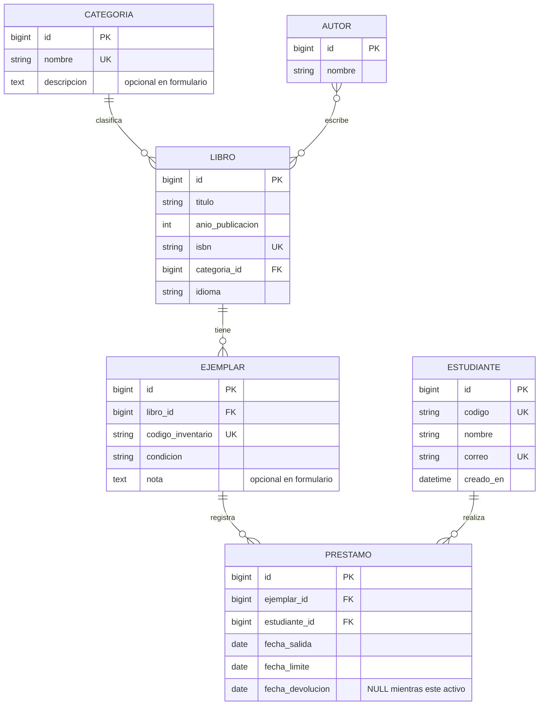

# 1. Biblioteca UFPS

Sistema de biblioteca universitaria desarrollado con Django para gestionar el catálogo, las copias físicas, los estudiantes y el historial de préstamos. La bibliotecaria trabaja desde un panel de administración en español, con búsquedas, filtros y una regla que impide dos préstamos activos de la misma copia.

Implementa las ocho fases de [la actividad de clase](./actividad-biblioteca-django.pdf). La interfaz del programa es el **admin de Django**, disponible en `/admin/`; la dirección raíz redirige a ese panel.

## 2. Tecnologías

| Componente | Versión usada y comprobada |
| --- | --- |
| Python | 3.15.2 |
| Django | 6.1.3 |
| SQLite | 3.53.4, incorporada en el Python del entorno de desarrollo |
| Dependencias | Versiones exactas en [requirements.txt](./requirements.txt), obtenidas con `pip freeze` en el entorno virtual |

SQLite se crea localmente al migrar; su versión depende de la instalación de Python. No requiere instalar un servidor de base de datos. La versión de Django fijada requiere Python 3.12 o posterior; la combinación ejecutada en este proyecto es la de la tabla.

## 3. Instalación, ejecución y verificación

### Desde cero en Windows / PowerShell

Requisitos: Python y Git instalados. El repositorio público del grupo es [`DidelphisAlbiventris/Biblioteca`](https://github.com/DidelphisAlbiventris/Biblioteca).

```powershell
git clone https://github.com/DidelphisAlbiventris/Biblioteca.git biblioteca-ufps
cd biblioteca-ufps
python -m venv .venv
.\.venv\Scripts\python.exe -m pip install -r requirements.txt
.\.venv\Scripts\python.exe manage.py migrate
.\.venv\Scripts\python.exe manage.py datos_demo
.\.venv\Scripts\python.exe manage.py createsuperuser
.\.venv\Scripts\python.exe manage.py runserver
```

Abre <http://127.0.0.1:8000/admin/> e ingresa con la cuenta que acabas de crear. `createsuperuser` solicita usuario, correo y contraseña en la terminal; no hay credenciales predefinidas en el código. Usar directamente el ejecutable de `.venv` evita tener que modificar la política de ejecución de PowerShell para activar el entorno.

### Linux / macOS / Codespaces

```bash
git clone https://github.com/DidelphisAlbiventris/Biblioteca.git biblioteca-ufps
cd biblioteca-ufps
python3 -m venv .venv
source .venv/bin/activate
python -m pip install -r requirements.txt
python manage.py migrate
python manage.py datos_demo
python manage.py createsuperuser
python manage.py runserver
```

En Codespaces puede ser necesario ejecutar `python manage.py runserver 0.0.0.0:8000`, abrir el puerto reenviado y añadir su dominio exacto a `DJANGO_ALLOWED_HOSTS`. Al finalizar: guardar los cambios, hacer push, detener el Codespace y borrarlo si ya no se necesita.

### Comprobar el proyecto

Los siguientes comandos de PowerShell comprueban configuración, cambios pendientes de migración, pruebas y ejercicios:

```powershell
.\.venv\Scripts\python.exe manage.py check
.\.venv\Scripts\python.exe manage.py makemigrations --check --dry-run
.\.venv\Scripts\python.exe manage.py test --verbosity 2
.\.venv\Scripts\python.exe manage.py demostrar_orm
```

Resultado de la verificación: **42 pruebas aprobadas**, sin problemas detectados por `check` y sin migraciones faltantes. Las pruebas usan una base temporal separada y no modifican la biblioteca local. Cubren las restricciones de la base, las relaciones, los diez retos, las consultas N+1 y las operaciones del admin, incluido crear y devolver un préstamo desde sus formularios.

### Datos de demostración

Lee [el comando de carga](./biblioteca/management/commands/datos_demo.py) antes de ejecutarlo, como solicita el PDF. En una base vacía crea:

| Entidad | Cantidad |
| --- | ---: |
| Categorías | 2 |
| Autores | 3 |
| Libros | 5 |
| Copias físicas | 8 |
| Estudiantes | 4 |
| Préstamos | 6: tres devueltos y tres activos |

Los nombres y correos de estudiantes son ficticios; los correos usan `example.com`. Las fechas de los préstamos son de enero de 2026 y son fijas para que repetir el comando no genere registros nuevos. Por ello, los tres préstamos activos aparecen también como vencidos cuando se consulta después del 19 de enero de 2026.

La carga es **idempotente**: se puede repetir, no borra registros ni reemplaza datos ya editados. Si encuentra un conflicto con un préstamo activo o un código de inventario utilizado para otro libro, falla y revierte la carga completa. La demostración ORM presupone los datos originales de práctica y que `INV-001` sigue prestado; para experimentar con datos diferentes, usa otra copia local del proyecto y su propia base.

### Configuración local

En [la configuración](./config/settings.py), `DJANGO_DEBUG` vale `1` para desarrollo, la zona horaria es `America/Bogota` y los hosts predeterminados son locales. `DJANGO_SECRET_KEY` se toma de una variable de entorno. Si no existe en desarrollo, se genera una clave aleatoria en memoria: las sesiones anteriores dejan de servir al reiniciar el proceso. Puedes mantener la misma sesión entre reinicios definiendo una clave persistente en tu entorno. No se carga automáticamente un archivo `.env` ni se incluye uno con secretos.

Al definir `DJANGO_DEBUG=0`, también debes establecer `DJANGO_SECRET_KEY`; de lo contrario el proyecto se detiene con un mensaje explícito. La configuración incluida está destinada al ejercicio local.

### Migraciones y SQL: fase 3

```powershell
.\.venv\Scripts\python.exe manage.py showmigrations biblioteca
.\.venv\Scripts\python.exe manage.py sqlmigrate biblioteca 0001
.\.venv\Scripts\python.exe manage.py sqlmigrate biblioteca 0002
```

- [0001_initial.py](./biblioteca/migrations/0001_initial.py) crea los seis modelos, sus relaciones, índices y restricciones. En sus operaciones `CreateModel` se reconocen los campos; en `AddConstraint`, las reglas de integridad.
- [0002_libro_idioma.py](./biblioteca/migrations/0002_libro_idioma.py) reproduce el ejercicio de agregar después un campo: incorpora `idioma`, con valor predeterminado `Español` para los libros existentes. Se generó y aplicó por separado.
- Las tablas son `biblioteca_autor`, `biblioteca_categoria`, `biblioteca_estudiante`, `biblioteca_libro`, `biblioteca_ejemplar` y `biblioteca_prestamo`. Django crea además `biblioteca_libro_autores` para la relación de muchos a muchos.
- `makemigrations` escribe la descripción del cambio; `sqlmigrate` permite inspeccionar su SQL; `migrate` lo aplica y deja constancia en `django_migrations`.
- Si se añade un campo obligatorio sin valor predeterminado a una tabla con registros, Django pide un valor para las filas existentes o permite cancelar para corregir el modelo. Aquí no hizo falta una respuesta interactiva porque el valor predeterminado quedó explícito.

Fragmento observado con `sqlmigrate biblioteca 0001`:

```sql
CREATE UNIQUE INDEX "un_prestamo_activo_por_ejemplar"
ON "biblioteca_prestamo" ("ejemplar_id")
WHERE "fecha_devolucion" IS NULL;
```

## 4. Estructura y conceptos del proyecto

```text
.
├── manage.py
├── requirements.txt
├── .gitignore
├── .gitattributes
├── README.md
├── actividad-biblioteca-django.pdf
├── config/
│   ├── settings.py
│   ├── urls.py
│   ├── asgi.py
│   └── wsgi.py
├── biblioteca/
│   ├── apps.py
│   ├── models.py
│   ├── admin.py
│   ├── consultas.py
│   ├── migrations/
│   │   ├── 0001_initial.py
│   │   └── 0002_libro_idioma.py
│   ├── management/commands/
│   │   ├── datos_demo.py
│   │   └── demostrar_orm.py
│   └── tests/
│       ├── test_models.py
│       ├── test_consultas.py
│       └── test_admin.py
└── docs/
    └── evidencia_orm.json
```

- [config/](./config/) es el **proyecto**: reúne configuración, rutas y puntos de entrada ASGI/WSGI.
- [biblioteca/](./biblioteca/) es la **app**: concentra la funcionalidad del dominio. Se registra en `INSTALLED_APPS`; sin ese registro Django no descubre normalmente sus modelos, migraciones ni su administración.
- [manage.py](./manage.py) ejecuta comandos de Django con la configuración del proyecto: servidor, migraciones, shell, pruebas y creación de usuarios.
- [models.py](./biblioteca/models.py) define las entidades y reglas; [admin.py](./biblioteca/admin.py) configura la interfaz para la bibliotecaria.
- [consultas.py](./biblioteca/consultas.py) implementa los ejercicios y las mediciones; [los comandos](./biblioteca/management/commands/) permiten repetirlos.
- [Las migraciones](./biblioteca/migrations/) se versionan para reconstruir el esquema. `db.sqlite3` no se versiona porque contiene datos y usuarios locales; cada persona reconstruye su base con migraciones y datos demo.
- [Las pruebas](./biblioteca/tests/) verifican comportamiento y resultados reales. [La evidencia JSON](./docs/evidencia_orm.json) conserva una ejecución de los retos y las mediciones.
- [El archivo de exclusiones](./.gitignore) evita subir el entorno virtual, cachés de Python, SQLite, archivos `.env` y herramientas temporales.
- [Los atributos de Git](./.gitattributes) conservan el PDF como archivo binario y mantienen finales de línea uniformes en el código.

## 5. Diseño y modelo de datos

### Entidades, campos y relaciones

El diseño separa tres grupos de información del enunciado:

| Entidad | Datos que conserva | Relación principal |
| --- | --- | --- |
| Categoría | Nombre único, descripción opcional | Tiene varios libros |
| Autor | Nombre | Escribe varios libros y admite coautoría |
| Libro | Título, año, ISBN único, idioma | Pertenece a una categoría y tiene autores y copias |
| Ejemplar | Código único de inventario, condición, nota opcional | Es una copia de un libro |
| Estudiante | Código único, nombre, correo único, fecha de registro | Tiene historial de préstamos |
| Préstamo | Salida, límite, devolución opcional | Relaciona un estudiante con una copia física |

### Diagrama Mermaid revisado



El diagrama representa las relaciones del esquema, incluida la posibilidad de cero registros relacionados. La tabla intermedia de autores es implícita en el dibujo y explícita en el SQL. `autores` se exige al registrar un libro en el formulario, pero la tabla intermedia puede quedar sin enlaces si se eliminan sus autores. `fecha_devolucion` es nullable; las cuatro claves foráneas son obligatorias. Ninguna relación de clave foránea es opcional.

1. Una categoría clasifica cero o muchos libros; cada libro pertenece exactamente a una categoría.
2. Un autor puede escribir varios libros y un libro puede tener varios autores: muchos a muchos, implementado por Django mediante la tabla intermedia.
3. Un libro tiene cero o muchas copias físicas; cada copia pertenece exactamente a un libro. Separarlos evita repetir título, ISBN y autores para cada copia.
4. Una copia tiene cero o muchos préstamos **a lo largo del tiempo**; cada préstamo corresponde exactamente a una copia. La unicidad parcial limita los activos a uno, sin eliminar el historial.
5. Un estudiante realiza cero o muchos préstamos; cada préstamo pertenece exactamente a un estudiante.

### Decisión de borrado

Se usa `on_delete=PROTECT` en libro → categoría, ejemplar → libro, préstamo → ejemplar y préstamo → estudiante. Así no se elimina una categoría con libros, un libro con inventario ni una copia o estudiante con historial, aunque todos sus préstamos hayan sido devueltos. Se evita perder trazabilidad por un borrado accidental.

La relación libro–autor es `ManyToManyField`: no recibe un argumento `on_delete`. La tabla intermedia que Django genera elimina sus enlaces con `CASCADE` al borrar un autor. **Los libros permanecen**: esa es la observación del reto 10.

### Regla de copia prestada

La protección principal es una **restricción de unicidad condicional en la base de datos**:

```python
models.UniqueConstraint(
    fields=["ejemplar"],
    condition=Q(fecha_devolucion__isnull=True),
    name="un_prestamo_activo_por_ejemplar",
)
```

Se eligió porque también protege los guardados del shell, los `create`, las actualizaciones directas y las escrituras concurrentes, aunque no se invoque `full_clean()`. `clean()` añade un error comprensible junto al campo de copia física en el admin; no sustituye la garantía de la base. Un préstamo está activo si y solo si `fecha_devolucion is None`, aunque ya haya vencido. Las devoluciones usan `null=True, blank=True` para permitir tanto el valor SQL `NULL` como el formulario vacío.

También hay restricciones para impedir año cero, condiciones fuera de las opciones y fechas límite o de devolución anteriores a la salida. Los validadores del formulario comprueban formato de correo e ISBN de 10 o 13 caracteres sin guiones; el validador de ISBN comprueba longitud y caracteres, no su dígito de control.

Prueba directa de la regla desde el shell, con los datos demo y sin llamar a `full_clean()`:

```python
from django.db import IntegrityError, transaction
from django.utils import timezone
from biblioteca.models import Ejemplar, Estudiante, Prestamo

try:
    with transaction.atomic():
        Prestamo.objects.create(
            ejemplar=Ejemplar.objects.get(codigo_inventario="INV-001"),
            estudiante=Estudiante.objects.get(codigo="1150004"),
            fecha_limite=timezone.localdate(),
        )
except IntegrityError:
    print("Rechazado: la copia ya está prestada")
```

Predicción y resultado comprobado: `Rechazado: la copia ya está prestada`. La prueba automatizada confirma además que solo queda un préstamo activo de esa copia. Tras devolverla, sí admite uno nuevo.

## 6. Panel de administración

Todos los modelos tienen `__str__` legible y están registrados mediante `@admin.register` y su `ModelAdmin`.

| Personalización | Modelos | Necesidad que resuelve |
| --- | --- | --- |
| `list_display`, `search_fields`, `list_filter` | Los seis modelos | Identificar registros y acotar listas sin conocer SQL |
| Copias como `TabularInline` | Libro | Registrar el inventario dentro de su libro |
| `readonly_fields` | Estudiante: `creado_en` | Consultar la fecha automática sin alterarla |
| Autocompletar estudiante | Préstamo | Buscar por código, nombre o correo |
| Autocompletar copia | Préstamo | Buscar inventario, título o ISBN y ver inventario + título + condición en la etiqueta |
| Filtro de estado y columna «Sin devolver» | Préstamo | Distinguir activos, vencidos y devueltos de un vistazo |
| Acción «Marcar préstamos seleccionados como devueltos hoy» | Préstamo | Registrar devoluciones en lote |
| Disponibilidad calculada | Copia física | Ver cuáles tienen un préstamo activo |

Para registrar un préstamo: abre **Préstamos → Añadir**, busca al estudiante, elige el código de la copia verificando su título, indica salida y fecha límite, y deja vacía la devolución. Si la copia está prestada, aparece el error y no se guarda el duplicado. Para devolverla, registra la fecha real o usa la acción en lote.

La acción conserva las fechas de los préstamos ya devueltos y omite salidas futuras para no registrar una devolución anterior a la salida. Las listas usan `select_related`, `prefetch_related`, anotaciones de conteo y `Exists` para evitar nuevas consultas por cada fila.

## 7. Los diez retos del ORM

### Cómo reproducir la evidencia

Después de cargar la demostración, abre el shell:

```powershell
.\.venv\Scripts\python.exe manage.py shell
```

Dentro del shell puedes ejecutar los diez retos reales de una vez:

```python
from pprint import pprint
from biblioteca.consultas import ejecutar_retos
pprint(ejecutar_retos())
```

Esta función ejecuta escrituras y consultas dentro de una transacción y **revierte las modificaciones al terminar**. El reto 9 sí guarda y vuelve a leer su cambio antes de esa reversión. Así se puede repetir la evidencia sin borrar los datos demo.

El comando `demostrar_orm` automatiza lo mismo y añade las mediciones. [evidencia_orm.json](./docs/evidencia_orm.json) contiene la salida capturada el **22 de noviembre de 2026**. Para recrearla desde el shell no se necesitan herramientas adicionales.

Los fragmentos siguientes explican cada operación. Si se pegan manualmente, deben ejecutarse **en orden en una base de práctica**: a diferencia de la función anterior, los fragmentos sueltos sí conservan sus cambios. Antes de cada consulta se incluye la predicción, y debajo se compara con el resultado observado.

Importaciones para los fragmentos:

```python
from django.db.models import Count, Q
from django.utils import timezone
from biblioteca.models import Autor, Categoria, Libro, Ejemplar, Estudiante, Prestamo
```

### Reto 1. Crear autor, libro y dos copias desde el shell

```python
# Predicción: un autor, un libro relacionado y dos copias distintas.
autor = Autor.objects.create(nombre="Autor de práctica")
libro = Libro.objects.create(
    titulo="Libro creado desde el shell", anio_publicacion=2026,
    isbn="9780306406157", categoria=Categoria.objects.get(nombre="Novela"),
)
libro.autores.add(autor)
Ejemplar.objects.create(libro=libro, codigo_inventario="PRACTICA-01")
Ejemplar.objects.create(libro=libro, codigo_inventario="PRACTICA-02")
list(libro.ejemplares.values_list("codigo_inventario", flat=True))
```

**Resultado:** `['PRACTICA-01', 'PRACTICA-02']`. Se comprobó también el nombre del autor y el título. Coincide con la predicción. Mientras dura la práctica hay seis libros y diez copias.

### Reto 2. Libros de un autor buscado por su nombre

```python
# Predicción: los dos libros de Gabriel García Márquez.
list(Libro.objects.filter(autores__nombre="Gabriel García Márquez")
     .values_list("titulo", flat=True))
```

**Resultado:** `['Cien años de soledad', 'El amor en los tiempos del cólera']`. Coincide.

### Reto 3. Título que contiene una palabra sin exigir mayúsculas

```python
# Predicción: buscar LIMPIO encuentra Código limpio.
list(Libro.objects.filter(titulo__icontains="LIMPIO")
     .values_list("titulo", flat=True))
```

**Resultado:** `['Código limpio']`. Coincide. En SQLite el comportamiento de `LIKE` con mayúsculas de caracteres no ASCII tiene limitaciones; este ejemplo comprueba la búsqueda con la palabra ASCII `LIMPIO`.

### Reto 4. Copias disponibles

```python
# Predicción: cinco copias originales más las dos creadas en el reto 1.
activos = Prestamo.objects.filter(fecha_devolucion__isnull=True).values("ejemplar_id")
disponibles = Ejemplar.objects.exclude(pk__in=activos)
list(disponibles.values_list("codigo_inventario", flat=True))
```

**Resultado:** `['INV-002', 'INV-003', 'INV-005', 'INV-006', 'INV-008', 'PRACTICA-01', 'PRACTICA-02']`. Coincide. La subconsulta excluye cualquier copia con un préstamo activo, aunque también tenga préstamos antiguos devueltos. `INV-001` prueba ese caso: no puede considerarse disponible por su devolución histórica.

### Reto 5. Estudiantes con al menos un préstamo activo, sin repetir

```python
# Predicción: Ana, Luis y María; Pedro nunca ha pedido un préstamo.
list(Estudiante.objects.filter(
    prestamos__fecha_devolucion__isnull=True,
    prestamos__isnull=False,
).distinct().values_list("nombre", flat=True))
```

**Resultado:** `['Ana Torres', 'Luis Pérez', 'María Rojas']`. Coincide. La condición `prestamos__isnull=False` evita incluir a estudiantes sin préstamos cuando el JOIN produce columnas nulas; `distinct()` elimina repeticiones si alguien tiene varias copias prestadas.

### Reto 6. Total de préstamos por estudiante, incluidos los devueltos

```python
# Predicción: Ana 3, Luis 2, María 1 y Pedro 0.
list(Estudiante.objects.annotate(total_prestamos=Count("prestamos"))
     .values("nombre", "total_prestamos"))
```

**Resultado:**

```python
[
    {'nombre': 'Ana Torres', 'total_prestamos': 3},
    {'nombre': 'Luis Pérez', 'total_prestamos': 2},
    {'nombre': 'María Rojas', 'total_prestamos': 1},
    {'nombre': 'Pedro Gómez', 'total_prestamos': 0},
]
```

Coincide. Se cuenta todo el historial y también se muestra al estudiante sin movimientos.

### Reto 7. Libro más prestado

```python
# Predicción: Cien años de soledad, con tres préstamos entre sus dos copias.
mas_prestado = Libro.objects.annotate(
    total_prestamos=Count("ejemplares__prestamos")
).order_by("-total_prestamos", "titulo", "pk").first()
(mas_prestado.titulo, mas_prestado.total_prestamos)
```

**Resultado:** `('Cien años de soledad', 3)`. Coincide. El recorrido atraviesa libro → ejemplares → préstamos. El título y la clave primaria permiten resolver empates de forma determinista.

### Reto 8. Estudiantes que nunca han pedido préstamos

```python
# Predicción: solo Pedro, quien no tiene ningún registro en el historial.
list(Estudiante.objects.filter(prestamos__isnull=True)
     .values_list("nombre", flat=True))
```

**Resultado:** `['Pedro Gómez']`. Coincide. Haber devuelto todos los préstamos no equivale a no haber pedido ninguno.

### Reto 9. Registrar y comprobar una devolución

```python
# Predicción: INV-001 se devuelve hoy; el préstamo queda inactivo y la copia disponible.
prestamo = Prestamo.objects.get(
    ejemplar__codigo_inventario="INV-001", fecha_devolucion__isnull=True
)
prestamo.fecha_devolucion = timezone.localdate()
prestamo.full_clean()
prestamo.save(update_fields=["fecha_devolucion"])
prestamo.refresh_from_db()
(prestamo.fecha_devolucion.isoformat(), prestamo.activo,
 disponibles.filter(pk=prestamo.ejemplar_id).exists())
```

**Resultado de la ejecución documentada:** `('2026-11-22', False, True)`. Coincide. La fecha cambia al día local de cada ejecución. `refresh_from_db()` verifica lo persistido y la consulta de disponibilidad se evalúa otra vez.

### Reto 10. Borrar un autor y observar sus libros

```python
# Predicción: desaparecen el autor de práctica y sus enlaces; libro y dos copias permanecen.
pk_libro, pk_autor = libro.pk, autor.pk
autor.delete()
(
    Autor.objects.filter(pk=pk_autor).exists(),
    Libro.objects.filter(pk=pk_libro).exists(),
    list(libro.autores.values_list("nombre", flat=True)),
    libro.ejemplares.count(),
)
```

**Resultado:** `(False, True, [], 2)`. Coincide. El borrado en cascada afecta a los enlaces de la tabla intermedia de autores, no al libro. El préstamo apunta al ejemplar y nunca al autor, por lo que su historial tampoco se elimina.

### Vocabulario adicional de la fase 5

Los diez retos anteriores ya usan `all`, `create`, `get`, `filter`, `exclude`, `__isnull`, relaciones, `annotate`, `Count`, `order_by`, `first` y `distinct`. Estos ejemplos adicionales de [consultas.py](./biblioteca/consultas.py) ejercitan `Q`, `aggregate`, `__gte` y `__lt`:

```python
# Predicción y resultado: los cinco libros originales del catálogo.
Libro.objects.filter(Q(categoria__nombre="Novela") | Q(categoria__nombre="Ingeniería"))
# Predicción y resultado: Arquitectura limpia y Código limpio.
Libro.objects.filter(anio_publicacion__gte=2000)
# Predicción y resultado: Cien años de soledad, El amor... y La casa de los espíritus.
Libro.objects.filter(anio_publicacion__lt=2000)
# Predicción y resultado: {'total': 6}.
Prestamo.objects.aggregate(total=Count("pk"))
```

Las cantidades de estos ejemplos corresponden a la base original: la ejecución automática revierte los retos antes de evaluarlos.

## 8. Optimización: problema N+1

Se midió con `CaptureQueriesContext`, evaluando realmente cada iteración. Los conteos previos de registros se hacen **fuera** del bloque de medición, y cada bloque usa un queryset nuevo para evitar resultados en caché.

**Predicción antes de ejecutar:** con seis préstamos, el primer caso realiza `1 + 3 × 6 = 19` consultas: una para la lista, y tres por fila para estudiante, ejemplar y libro. Con cinco libros, el segundo realiza `1 + 5 = 6`: una para libros y una por cada lista de autores.

### Préstamos, antes y después

```python
from django.db import connection
from django.test.utils import CaptureQueriesContext

with CaptureQueriesContext(connection) as antes:
    filas_antes = [
        (p.estudiante.nombre, p.ejemplar.libro.titulo)
        for p in Prestamo.objects.all()
    ]

with CaptureQueriesContext(connection) as despues:
    filas_despues = [
        (p.estudiante.nombre, p.ejemplar.libro.titulo)
        for p in Prestamo.objects.select_related("estudiante", "ejemplar__libro")
    ]

print(len(antes), len(despues), filas_antes == filas_despues)
# Observado: 19 1 True
```

`select_related` une las claves foráneas en la misma consulta SQL y conserva las mismas filas.

### Libros y autores, antes y después

```python
with CaptureQueriesContext(connection) as antes:
    autores_antes = [
        (libro.titulo, [autor.nombre for autor in libro.autores.all()])
        for libro in Libro.objects.all()
    ]

with CaptureQueriesContext(connection) as despues:
    autores_despues = [
        (libro.titulo, [autor.nombre for autor in libro.autores.all()])
        for libro in Libro.objects.prefetch_related("autores")
    ]

print(len(antes), len(despues), autores_antes == autores_despues)
# Observado: 6 2 True
```

| Consulta | Número de consultas antes | Número después |
| --- | ---: | ---: |
| Seis préstamos con estudiante, copia y libro | 19 | 1 |
| Cinco libros con sus listas de autores | 6 | 2 |

Las dos predicciones coincidieron con la medición; también se verificó que los resultados fueran iguales antes y después.

**¿Por qué no sirve `select_related` para autores?** Cada libro puede tener muchos autores: un JOIN multiplicaría las filas de los libros. `select_related` recorre relaciones hacia un solo objeto (`ForeignKey` o `OneToOneField`), y no acepta el campo muchos a muchos `autores`. `prefetch_related` trae los libros en una consulta y todos sus autores en otra, y los agrupa en Python.

La tabla corresponde a la base demo original, medida antes de crear el libro temporal del reto 1. Si se ejecutan los fragmentos manualmente y se conserva ese sexto libro, el caso de autores tiene **7 antes y 2 después**; la fórmula permite predecir el nuevo valor. Si no hay libros, Django realiza una sola consulta y omite el prefetch.

Para repetir únicamente las mediciones desde el shell:

```python
from biblioteca.consultas import medir_consultas
pprint(medir_consultas())
```

## 9. Uso de inteligencia artificial y revisión

Se utilizó **Codex, agente de programación de OpenAI**, a petición del usuario, para leer el PDF, proponer el diseño, implementar Django, configurar el admin, generar un diagrama Mermaid y redactar ejercicios y pruebas. El pedido fue implementar el programa con todos los requisitos del PDF.

La revisión contrastó los nombres de campos y las cardinalidades contra [los modelos](./biblioteca/models.py) y [las migraciones](./biblioteca/migrations/). El bloque Mermaid se validó con el analizador de Mermaid 11.12.2 y se comprobó su renderizado real en un navegador. No se detectó un error de cardinalidad en el diagrama final; no se atribuye al agente una equivocación inexistente. Se dejaron explícitos dos puntos que suelen confundirse: borrar un autor elimina enlaces de la relación M2M, y las múltiples filas históricas de préstamos de una copia son compatibles con un único préstamo activo.

Durante la revisión del código se ajustó el ejemplo de búsqueda a la palabra `LIMPIO`, que permite comprobar las mayúsculas en SQLite sin atribuirle soporte completo de mayúsculas Unicode. También se protegió la acción de devolución para que no cambie fechas históricas ni devuelva antes de la salida, y se fijó el idioma español del admin independientemente de las preferencias del navegador. Las mediciones y las salidas del README se obtuvieron ejecutando el código, no estimándolas como si fueran resultados observados.

El grupo debe leer el código y completar sus datos y reflexiones personales antes de entregar. La generación asistida no sustituye esa revisión.

## 10. Equipo, reflexión y entrega

### Integrantes

- **Cesar Hernan Salas** — código estudiantil `1152518`
- **Johan Barrera** — código estudiantil `1152538`

### Reflexión técnica sobre esta implementación

1. **¿Qué cambió después de las primeras consultas y por qué?** Las consultas ejecutadas no exigieron cambiar las seis entidades. Sí orientaron la consulta de disponibilidad hacia una subconsulta de préstamos activos: una copia con historial devuelto y un préstamo activo no puede aparecer disponible. La medición también justificó cargar estudiante y libro con `select_related` y autores con `prefetch_related`. El campo `idioma` se añadió en una segunda migración para completar el ejercicio de evolución del esquema, no por un fallo de las consultas.
2. **¿En qué se equivocó el agente con el diagrama y cómo se notó?** La comparación realizada no encontró una cardinalidad incorrecta en el diagrama final. Se verificaron las claves foráneas obligatorias, la M2M y la devolución nullable contra el código. Se documentó expresamente que el mínimo de autores exigido en formularios no es una restricción de cantidad de enlaces en la base. El grupo debe complementar esta respuesta si identifica otros cambios durante su revisión.
3. **¿Qué decisión se defendería y cuál se cambiaría al empezar de nuevo?** Se defendería separar libro de ejemplar y proteger el historial con `PROTECT` y unicidad parcial: representan directamente el problema. Para una versión con necesidades adicionales se evaluaría guardar bajas lógicas de autores y estudiantes, en lugar de borrarlos físicamente, y modelar ediciones si la biblioteca necesita distinguir formatos de una misma obra. Esas extensiones no son requisitos de esta actividad.

### Entrega en GitHub y NPLAD

La implementación local no puede acreditar colaboración real de un grupo ni una entrega en NPLAD. Para completar esa parte del enunciado:

1. Crear o utilizar **un repositorio público del grupo**, invitar a todos los integrantes y darles permiso de escritura.
2. Mantener los nombres y códigos del equipo en esta sección y conservar la URL de clonación del repositorio público.
3. Conservar las migraciones, el código, el PDF, el README y las dependencias. Revisar `git status --ignored` para confirmar que no se agregan `.venv`, `db.sqlite3`, cachés ni secretos.
4. Cada integrante debe realizar aportes reales y subir sus propios commits. No se simula ese historial con identidades ajenas.
5. Subir la rama al repositorio público. Abrir su enlace en una ventana privada y confirmar que cualquiera pueda acceder.
6. Registrar **https://github.com/DidelphisAlbiventris/Biblioteca** en NPLAD antes de la fecha que publique el profesor.

La fecha límite no aparece en el PDF: se consulta en NPLAD. Los datos del equipo, la URL definitiva, la visibilidad pública y el historial de participación deben verificarse por el grupo antes de entregar.
